# Diagramas de arquitetura do NexFleet

Versão de referência: **v0.24.0**, revisada em 08/11/2026.

Este documento representa a implementação existente no repositório. Ele atualiza as figuras C4, UML e DER do documento normativo sem alterar o PDF original. Nomes de processos, classes, rotas e tabelas foram conferidos contra o código Java, o Docker Compose e as migrações Flyway.

## Convenções e limites

- Setas contínuas representam chamadas síncronas HTTP ou JDBC.
- Setas identificadas como evento representam comunicação assíncrona pelo RabbitMQ.
- Cada microsserviço acessa somente seu próprio banco PostgreSQL.
- UUIDs de outro domínio são referências lógicas; não existem chaves estrangeiras entre bancos.
- A Function registra uma notificação capturada localmente. Azure Communication Services Email foi recomendado, mas ainda não foi autorizado nem configurado.
- Azure é a implantação futura. Os diagramas abaixo descrevem o ambiente implementado e comprovado localmente.

## C4 — nível 1: contexto do sistema

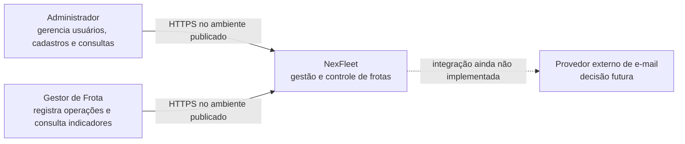

O motorista é uma entidade de negócio no MVP, sem login próprio. No ambiente local, o acesso web usa HTTP ligado a `127.0.0.1`; HTTPS pertence à publicação Azure.

## C4 — nível 2: contêineres e propriedade dos dados

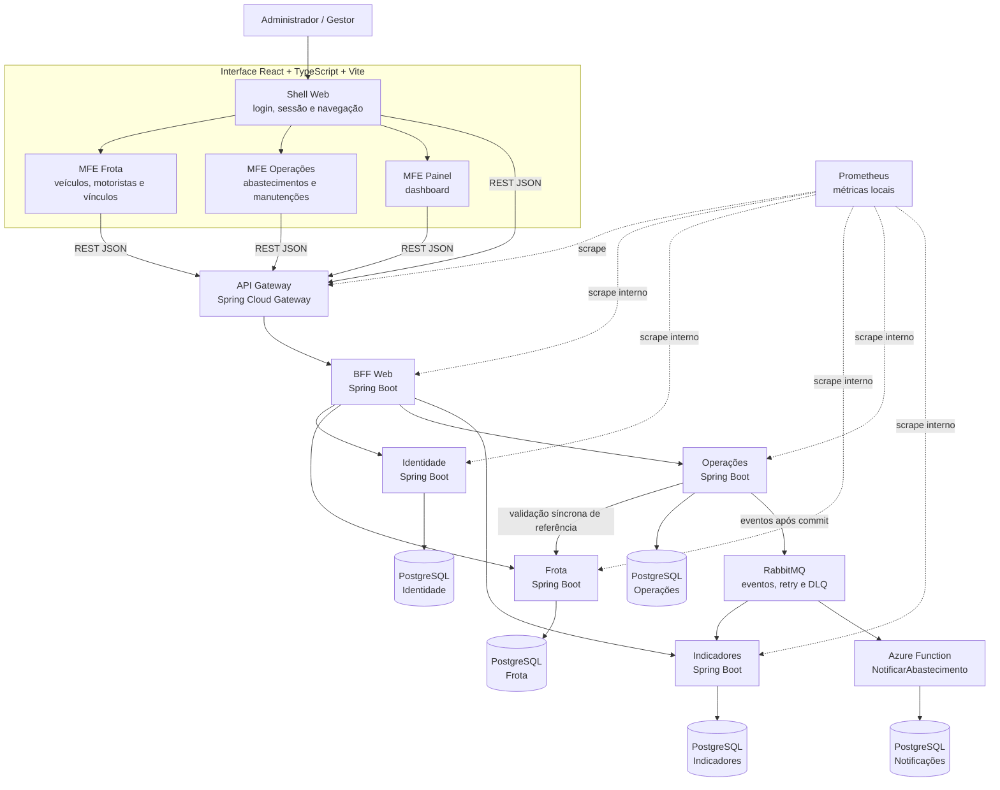

O Gateway é a única entrada pública das APIs no Compose. O BFF adapta os contratos para a interface, mas não acessa bancos de domínio. O dashboard é composto pelo BFF com dados de Frota e Indicadores.

## C4 — nível 3: componentes do serviço Operações

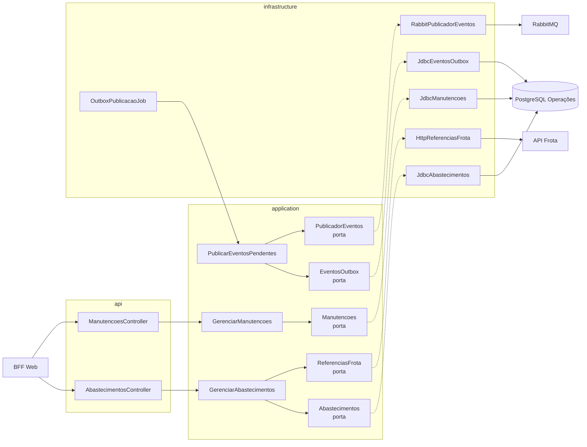

As interfaces em `application` são portas; os adaptadores em `infrastructure` as implementam. A transação de abastecimento está no método `JdbcAbastecimentos.registrar`, que grava hodômetro, abastecimento e outbox no mesmo banco.

## C4 — nível 4: código da fatia Registrar Abastecimento

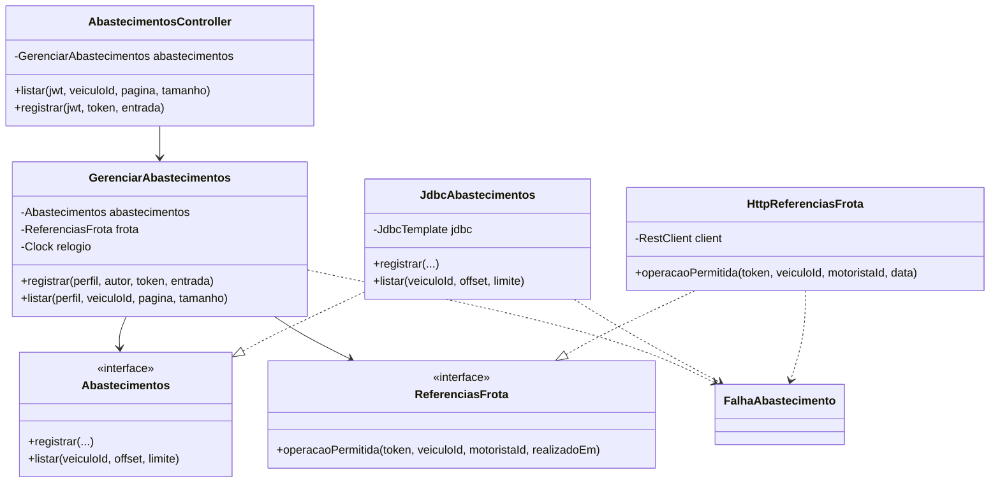

Esta é a estrutura real da v0.24.0. A fatia usa JDBC e não possui um pacote `domain` próprio; suas regras estão no caso de uso e no adaptador transacional. Os tipos de domínio compartilhados existentes ficam em fatias específicas, como `StatusVeiculo`, `StatusMotorista` e `Perfil`.

## UML de componentes: fluxo entre serviços

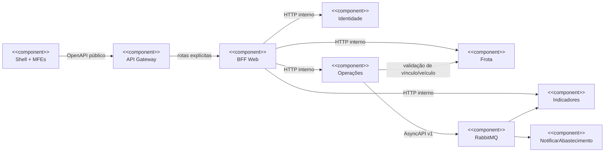

## UML de sequência: login e emissão do JWT

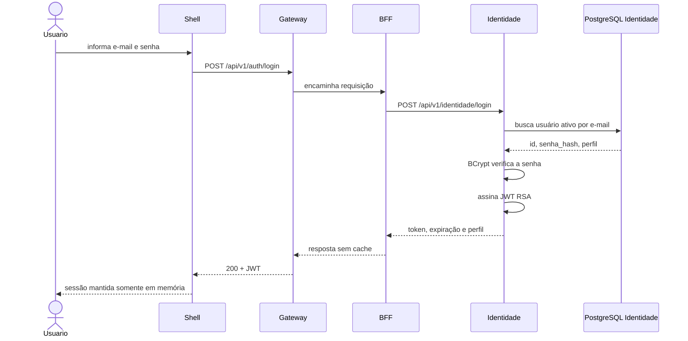

## UML de sequência: abastecimento confirmado e evento assíncrono

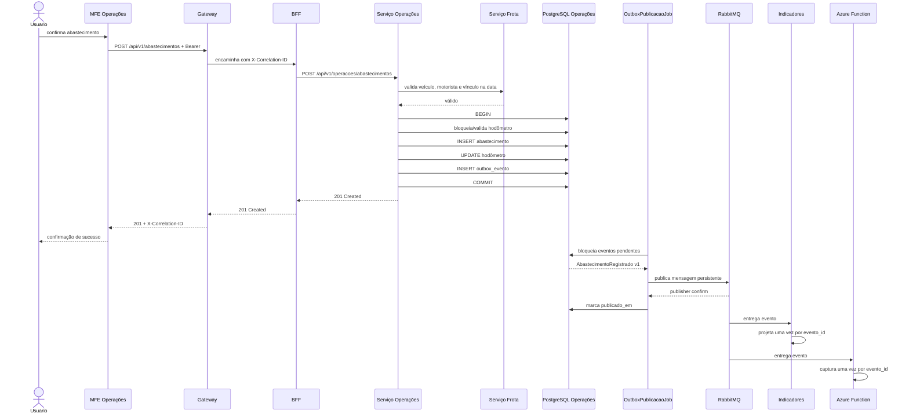

## UML de sequência: quilometragem regressiva

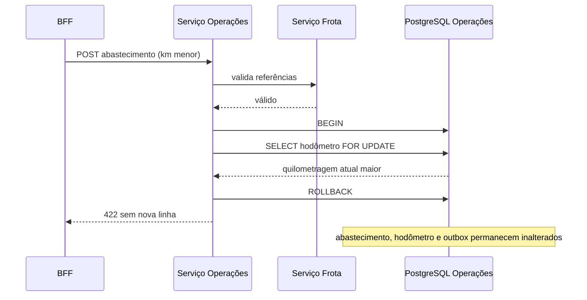

## DER físico: visão distribuída

Não existe um DER físico único nem um banco compartilhado. A lista abaixo é derivada das migrações Flyway atuais.

| Banco proprietário | Tabelas de negócio |
|---|---|
| Identidade | `identidade.usuario` |
| Frota | `frota.veiculo`, `frota.motorista`, `frota.veiculo_motorista` |
| Operações | `operacoes.hodometro`, `operacoes.abastecimento`, `operacoes.outbox_evento`, `operacoes.manutencao` |
| Indicadores | `indicadores.abastecimento_projecao`, `indicadores.manutencao_projecao` |
| Notificações | `notificacoes.email_capturado` |

As tabelas internas do Flyway não fazem parte do modelo de negócio.

### DER — Identidade

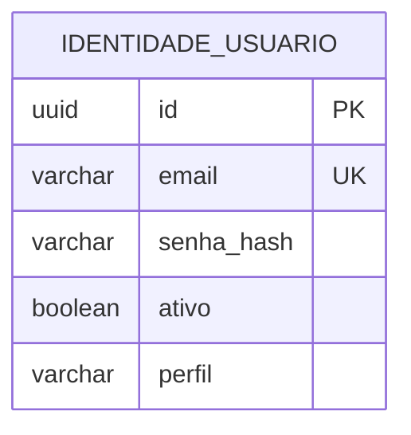

`email` é normalizado e único; `senha_hash` deve ter formato BCrypt; `perfil` aceita `ADMINISTRADOR` ou `GESTOR_FROTA`.

### DER — Frota

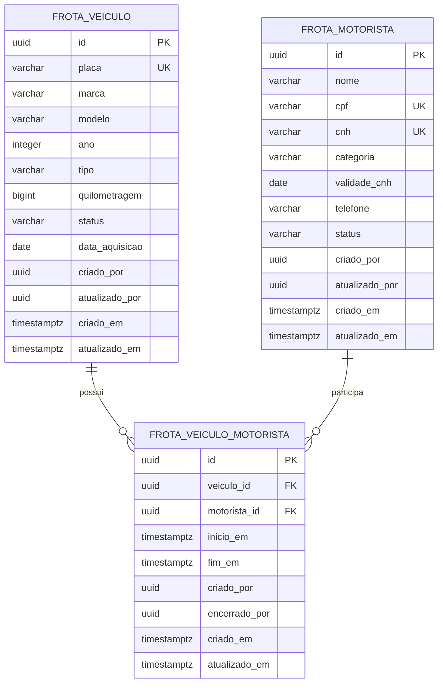

As duas chaves estrangeiras pertencem ao próprio banco de Frota. Um índice parcial permite no máximo um vínculo ativo por veículo; vínculos encerrados permanecem no histórico.

### DER — Operações

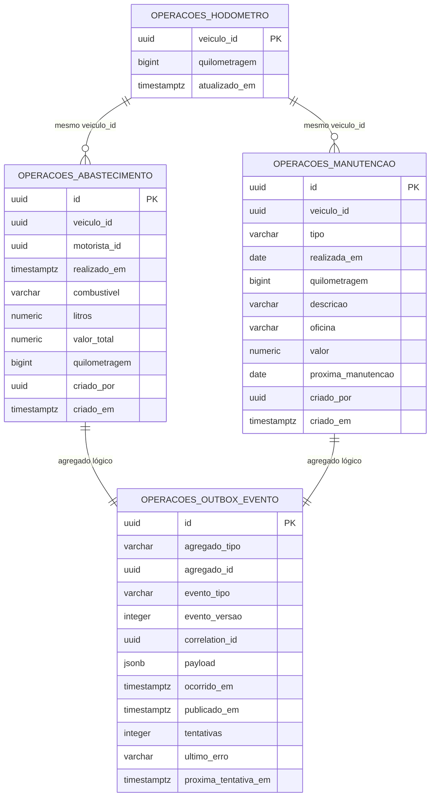

As linhas do diagrama representam relações lógicas por UUID. Cada abastecimento ou manutenção registrado gera seu próprio evento; `agregado_tipo` identifica qual das duas relações se aplica. As migrações atuais não criam FKs entre essas tabelas; a consistência crítica de abastecimento, hodômetro e outbox é protegida pela transação e pelo bloqueio `FOR UPDATE`. `veiculo_id` e `motorista_id` não apontam por FK para Frota porque pertencem a outro banco.

### DER — Indicadores

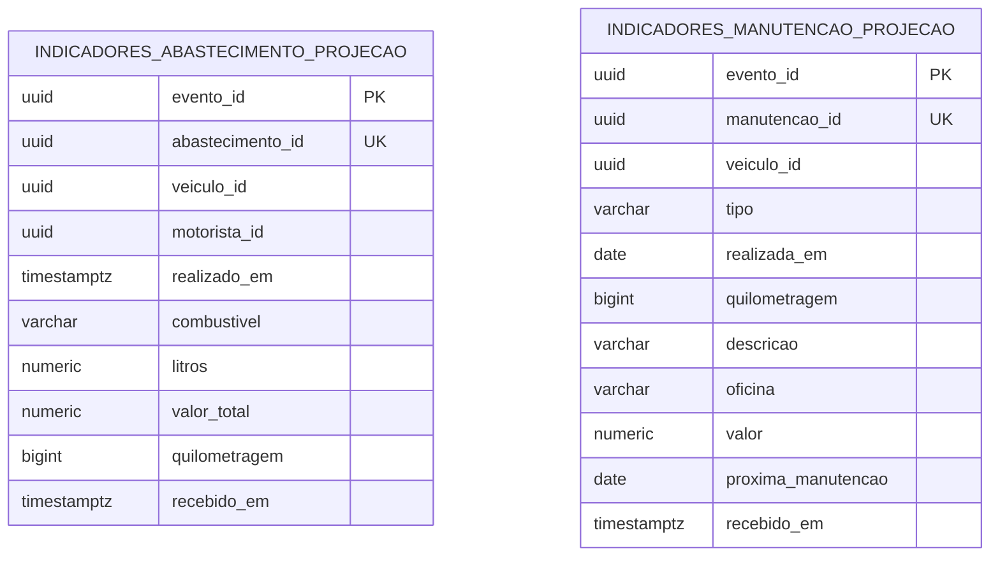

`evento_id` torna o consumo idempotente. As projeções são reconstruíveis a partir dos eventos e não possuem FKs para Operações ou Frota.

### DER — Notificações locais

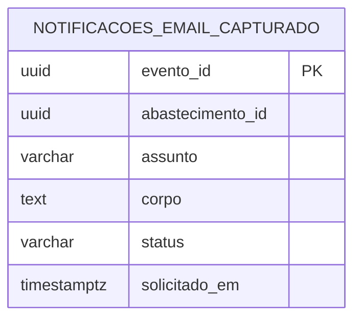

O status atual é sempre `CAPTURADO_LOCALMENTE`. Esta tabela não comprova envio de e-mail externo.

## Rastreabilidade entre diagrama e código

| Visão | Fontes verificadas |
|---|---|
| C4 nível 1 | `docs/reference/ArqCloud_PJBL-Completo.pdf`, escopo e atores |
| C4 nível 2 | `compose.sprint0.yaml`, `compose.jwt-rsa.yaml`, shell e três MFEs |
| C4 nível 3 | pacotes de `services/operacoes/src/main/java` |
| C4 nível 4 | `AbastecimentosController`, `GerenciarAbastecimentos`, `Abastecimentos`, `ReferenciasFrota`, `JdbcAbastecimentos`, `HttpReferenciasFrota` |
| UML de componentes | `GatewayConfig`, `AbastecimentosWebController`, `GerenciarAbastecimentosWeb`, `HttpAbastecimentos`, `RabbitAbastecimentoListener` e `NotificarAbastecimentoFunction` |
| UML de sequência | `OutboxPublicacaoJob`, `PublicarEventosPendentes`, `RabbitPublicadorEventos`, `ProjetarAbastecimento`, `JdbcProjecoesAbastecimento`, `NotificarAbastecimento` e `JdbcProvedorEmailCapturado` |
| DER | todas as migrações em `services/*/src/main/resources/db/migration` e `functions/notificar-abastecimento/src/main/resources/db/migration` |

## Regra de manutenção

Uma mudança em rota, fronteira de serviço, nome de classe relevante, evento ou migração deve atualizar este arquivo na mesma entrega. O módulo `quality` verifica a presença dos níveis C4, das visões UML, das onze tabelas de negócio migradas e das principais classes do fluxo crítico.
