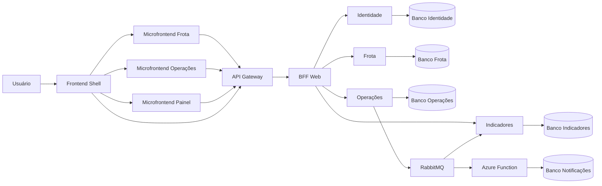

# Guia de estrutura e arquitetura do NexFleet

Este documento explica como o repositório NexFleet está organizado, qual é a responsabilidade de cada pasta e como uma ação feita no navegador percorre o sistema até chegar ao banco de dados.

## 1. Ideia central

O NexFleet separa interface, entrada HTTP, adaptação para o frontend, regras de negócio, persistência e processamento assíncrono.

A interface não acessa o PostgreSQL diretamente. O fluxo normal é:



Essa separação evita SQL no frontend, reduz o acoplamento entre domínios e permite que cada serviço tenha suas próprias regras, credenciais e banco.

## 2. Estrutura da raiz

```text
NexFleet-v0.14.0/
├── frontend/                 shell React
├── microfrontends/           áreas independentes da interface
├── contracts/                contratos OpenAPI e AsyncAPI
├── quality/                  testes executáveis dos contratos
├── services/                 microsserviços Java/Spring Boot
├── functions/                Azure Function acionada por evento
├── infra/                    Dockerfiles e configurações técnicas
├── scripts/                  automação local e testes
├── docs/                     documentação e decisões
├── .github/                  integração contínua
├── compose.sprint0.yaml      ambiente Docker principal
├── compose.sprint1-local.yaml provisionamento do usuário local
├── compose.jwt-rsa.yaml      autenticação JWT RSA
├── compose.db-access.yaml    acesso gráfico opcional aos bancos
├── .env.sprint0              configuração e segredos locais
└── .secrets/                 chave privada RSA local
```

## 3. `frontend/` — shell da aplicação

O diretório [`frontend`](../frontend) contém a aplicação React principal. Ele não contém todas as telas do sistema; funciona como um shell que controla:

- login e sessão;
- menu lateral e navegação;
- gestão de usuários;
- carregamento dos microfrontends;
- envio do token para o microfrontend montado;
- tratamento de loading e indisponibilidade dos remotos.

### Arquivos principais

| Arquivo | Responsabilidade |
|---|---|
| [`index.html`](../frontend/index.html) | Documento HTML inicial e elemento onde o React é montado. |
| [`src/main.tsx`](../frontend/src/main.tsx) | Ponto de entrada que inicia a aplicação React. |
| [`src/App.tsx`](../frontend/src/App.tsx) | Layout principal, navegação, sessão e seleção das áreas. |
| [`src/Login.tsx`](../frontend/src/Login.tsx) | Formulário e estados visuais do login. |
| [`src/auth.ts`](../frontend/src/auth.ts) | Requisições de login e consulta do usuário autenticado. |
| [`src/Usuarios.tsx`](../frontend/src/Usuarios.tsx) | Tela de gestão de usuários. |
| [`src/usuarios-api.ts`](../frontend/src/usuarios-api.ts) | Cliente HTTP da área de usuários. |
| [`src/MicrofrontendHost.tsx`](../frontend/src/MicrofrontendHost.tsx) | Monta e desmonta um microfrontend remoto. |
| [`src/remotes.ts`](../frontend/src/remotes.ts) | Endereços e importação dos remotos. |
| [`src/style.css`](../frontend/src/style.css) | Estilos globais e do shell. |
| [`vite.config.ts`](../frontend/vite.config.ts) | Porta 5173 e proxy `/api` para o Gateway. |

### Arquivos de pacote

- `package.json`: dependências e comandos `dev`, `test` e `build`;
- `package-lock.json`: versões exatas das dependências instaladas;
- `tsconfig.json`: regras de compilação do TypeScript;
- arquivos `*.test.tsx`: testes dos componentes e fluxos do shell.

## 4. `microfrontends/` — áreas independentes

Cada microfrontend possui `package.json`, lockfile, testes, configuração Vite e build próprios. O shell conhece apenas a URL e o contrato `mount/unmount`; ele não importa diretamente os componentes internos dos remotos.

### 4.1. `microfrontends/frota`

O diretório [`microfrontends/frota`](../microfrontends/frota) é responsável por:

- veículos;
- motoristas;
- vínculos históricos entre veículo e motorista.

| Arquivo | Responsabilidade |
|---|---|
| [`src/FrotaApp.tsx`](../microfrontends/frota/src/FrotaApp.tsx) | Organiza as áreas Veículos, Motoristas e Vínculos. |
| [`src/Veiculos.tsx`](../microfrontends/frota/src/Veiculos.tsx) | Formulário, lista, edição, filtro e inativação de veículos. |
| [`src/veiculos-api.ts`](../microfrontends/frota/src/veiculos-api.ts) | Requisições da API de veículos. |
| [`src/Motoristas.tsx`](../microfrontends/frota/src/Motoristas.tsx) | Interface de motoristas. |
| [`src/motoristas-api.ts`](../microfrontends/frota/src/motoristas-api.ts) | Requisições da API de motoristas. |
| [`src/Vinculos.tsx`](../microfrontends/frota/src/Vinculos.tsx) | Interface de criação e encerramento de vínculos. |
| [`src/vinculos-api.ts`](../microfrontends/frota/src/vinculos-api.ts) | Requisições da API de vínculos. |
| [`src/entry.tsx`](../microfrontends/frota/src/entry.tsx) | Exporta o contrato usado pelo shell para montar o remoto. |
| [`src/dev.tsx`](../microfrontends/frota/src/dev.tsx) | Inicialização isolada para desenvolvimento visual. |
| [`src/style.css`](../microfrontends/frota/src/style.css) | Estilos da área de Frota. |

### 4.2. `microfrontends/operacoes`

O diretório [`microfrontends/operacoes`](../microfrontends/operacoes) contém:

- cadastro e histórico de abastecimentos;
- cadastro e histórico de manutenções;
- comunicação com as APIs operacionais.

O componente principal é [`OperacoesApp.tsx`](../microfrontends/operacoes/src/OperacoesApp.tsx). Os clientes HTTP ficam em `abastecimentos-api.ts` e `manutencoes-api.ts`.

### 4.3. `microfrontends/painel`

O diretório [`microfrontends/painel`](../microfrontends/painel) apresenta:

- gastos com abastecimentos;
- gastos com manutenções;
- situação da frota;
- próximas manutenções.

O componente principal é [`PainelApp.tsx`](../microfrontends/painel/src/PainelApp.tsx), e o cliente da API fica em `dashboard.ts`.

## 5. `contracts/` e `quality/` — contratos executáveis

O diretório [`contracts`](../contracts) contém arquivos OpenAPI e AsyncAPI em YAML. Eles documentam o acordo entre quem chama e quem implementa uma API ou evento:

- caminho do endpoint;
- método HTTP;
- parâmetros e campos obrigatórios;
- corpo da requisição;
- formato da resposta;
- códigos de sucesso e erro.

Exemplos:

- `veiculos.openapi.yaml`: veículos;
- `motoristas.openapi.yaml`: motoristas;
- `vinculos.openapi.yaml`: vínculos;
- `auth-web.openapi.yaml`: autenticação web;
- `usuarios.openapi.yaml`: usuários;
- `abastecimentos.openapi.yaml`: abastecimentos;
- `manutencoes.openapi.yaml`: manutenções;
- `dashboard.openapi.yaml`: dashboard.
- `eventos.asyncapi.yaml`: cabeçalhos, routing keys e payloads de `AbastecimentoRegistrado.v1` e `ManutencaoRegistrada.v1`.

O diretório [`quality`](../quality) é um pequeno projeto Maven separado das imagens dos serviços. `ContractFilesTest` carrega todos os YAMLs com rejeição de chaves duplicadas e confere:

- versão, título, versão do contrato e caminhos;
- `operationId` único, segurança, parâmetros e resposta de sucesso;
- resolução de todos os `$ref` locais;
- inventário das rotas públicas do BFF;
- dois canais de evento, ação `send`, versão e campos obrigatórios de correlação.

Os contratos não substituem a implementação. A verificação estática protege o formato dos documentos; os testes Java e o smoke E2E protegem o comportamento real. Quando uma API ou evento muda, contrato, produtor, consumidor, cliente e testes devem permanecer compatíveis.

## 6. `services/` — backend Java

O diretório [`services`](../services) é um projeto Maven com seis módulos Spring Boot definidos no `pom.xml` principal.

### 6.1. `gateway`

O API Gateway é a entrada pública das APIs. Ele recebe as chamadas encaminhadas pelo Vite e roteia caminhos explícitos para o BFF.

Ele não deve conter regra de negócio nem acessar banco. O roteamento fica em [`GatewayConfig.java`](../services/gateway/src/main/java/br/com/nexfleet/gateway/config/GatewayConfig.java).

### 6.2. `bff`

BFF significa **Backend for Frontend**. Ele fornece uma API adequada às telas e chama os serviços internos.

Responsabilidades:

- adaptar entrada e resposta para a interface web;
- encaminhar autenticação e operações;
- compor respostas de mais de um serviço, como o dashboard;
- validar a autenticação conforme a configuração RSA/JWKS.

O BFF não deve consultar diretamente os bancos de Identidade, Frota, Operações ou Indicadores.

### 6.3. `identidade`

Responsável por:

- usuários e perfis;
- hash de senha com BCrypt;
- login;
- emissão de JWT assinado com RSA;
- publicação da chave pública por JWKS;
- autorização das operações de usuários.

Somente Identidade possui acesso ao banco `identidade` e à chave privada de assinatura.

### 6.4. `frota`

Responsável por:

- cadastro, consulta, edição e inativação de veículos;
- cadastro e consulta de motoristas;
- vínculos históricos;
- regras como placa, CPF e CNH únicos.

O serviço possui seu próprio PostgreSQL e suas próprias migrações Flyway.

### 6.5. `operacoes`

Responsável por:

- abastecimentos;
- manutenções;
- hodômetro não regressivo;
- outbox transacional;
- publicação de eventos no RabbitMQ.

O registro operacional e seu evento de outbox são gravados na mesma transação. Dessa forma, uma indisponibilidade temporária do RabbitMQ não apaga o abastecimento já confirmado.

### 6.6. `indicadores`

Responsável por:

- consumir eventos do RabbitMQ;
- criar projeções próprias para leitura;
- impedir duplicação por `eventoId`;
- calcular dados financeiros e operacionais do dashboard;
- aplicar retry e encaminhar mensagens problemáticas para DLQ.

Indicadores não consulta as tabelas internas de Operações. Ele reage aos eventos e mantém seu próprio banco.

## 7. Organização interna de um serviço

O backend combina Vertical Slice e Clean Architecture. Em vez de colocar todas as funcionalidades em uma única pasta genérica de controllers ou repositories, cada objetivo de negócio agrupa suas camadas.

Exemplo:

```text
gerenciarveiculos/
├── api/
├── application/
└── infrastructure/

veiculo/
└── domain/
```

### `api/`

É a entrada HTTP. Um controller:

- recebe a requisição;
- lê identidade e perfil do JWT;
- converte JSON em objetos Java;
- chama o caso de uso;
- converte o resultado em resposta HTTP.

Não deve conter SQL nem concentrar regras de negócio.

### `application/`

Contém o caso de uso e as portas necessárias. Decide:

- se o perfil possui permissão;
- se a entrada é válida;
- qual operação deve acontecer;
- qual interface de persistência ou serviço remoto será utilizada.

Exemplo: [`GerenciarVeiculos.java`](../services/frota/src/main/java/br/com/nexfleet/frota/gerenciarveiculos/application/GerenciarVeiculos.java).

### `domain/`

Contém conceitos e invariantes centrais, como `StatusVeiculo`, `StatusMotorista` e `Perfil`. O domínio deve permanecer independente de detalhes HTTP, JDBC e Docker.

### `infrastructure/`

Contém adaptadores técnicos:

- acesso JDBC ao PostgreSQL;
- clientes HTTP;
- integração RabbitMQ;
- implementação das portas declaradas na aplicação.

Exemplo: [`JdbcVeiculos.java`](../services/frota/src/main/java/br/com/nexfleet/frota/gerenciarveiculos/infrastructure/JdbcVeiculos.java).

### `config/`

Configura segurança, JWT/JWKS, clientes HTTP, propriedades e composição das dependências Spring.

### `src/main/resources/`

- `application.properties`: propriedades do processo;
- `db/migration/`: migrações Flyway versionadas.

As alterações estruturais do banco devem entrar como uma nova migração. Não altere manualmente um banco como substituto da migração.

### `src/test/`

Contém testes unitários, HTTP, integração e ArchUnit. Os testes ArchUnit protegem regras como aplicação não depender de infraestrutura de forma incorreta.

## 8. `functions/` — processamento serverless

O diretório [`functions`](../functions) contém a Azure Function `notificar-abastecimento`.

Ela não é chamada diretamente pela tela. O gatilho é uma mensagem de abastecimento no RabbitMQ:

```text
Operações → outbox → RabbitMQ → fila de notificações → Azure Function
                                                        ↓
                                           banco de Notificações
```

Arquivos principais:

| Arquivo | Responsabilidade |
|---|---|
| `NotificarAbastecimentoFunction.java` | Recebe e traduz a mensagem do runtime. |
| `NotificarAbastecimento.java` | Valida e executa o caso de uso. |
| `ProvedorEmail.java` | Porta que descreve o provedor necessário. |
| `JdbcProvedorEmailCapturado.java` | Adaptador local idempotente. |
| `CompositionRoot.java` | Liga caso de uso e adaptador. |
| `host.json` | Configura o runtime Azure Functions. |

Localmente, a solicitação de notificação é capturada no PostgreSQL para auditoria. O projeto ainda não afirma o envio de um e-mail externo real.

## 9. `infra/` — infraestrutura técnica

O diretório [`infra`](../infra) contém arquivos usados para construir e operar os componentes:

| Caminho | Responsabilidade |
|---|---|
| `java/Dockerfile` | Constrói imagens dos serviços Java. |
| `azure-functions-java/Dockerfile` | Constrói a imagem da Azure Function. |
| `rabbitmq/Initialize-Topology.sh` | Cria exchanges, filas, bindings e DLQs. |
| `prometheus/prometheus.yml` | Define os serviços coletados pelo Prometheus. |

Infraestrutura define como os componentes executam e se conectam. Regras como “placa não pode ser duplicada” pertencem ao serviço de Frota, não a `infra`.

## 10. Arquivos Docker Compose

| Arquivo | Função |
|---|---|
| [`compose.sprint0.yaml`](../compose.sprint0.yaml) | Define serviços, bancos, RabbitMQ, Function, Azurite, Prometheus, redes e volumes. |
| [`compose.sprint1-local.yaml`](../compose.sprint1-local.yaml) | Ativa temporariamente o provisionamento do primeiro usuário. |
| [`compose.jwt-rsa.yaml`](../compose.jwt-rsa.yaml) | Ativa JWT RSA e monta a chave privada de forma controlada. |
| [`compose.db-access.yaml`](../compose.db-access.yaml) | Publica opcionalmente os bancos somente em `127.0.0.1`. |

O Compose descreve execução e conexão. Ele não implementa telas ou regras de domínio.

## 11. `scripts/` — automação

O diretório [`scripts`](../scripts) reúne tarefas repetitivas:

| Script | Função |
|---|---|
| `Initialize-Local.ps1` | Cria configuração e segredos locais. |
| `Install-Dependencies.ps1` | Instala runtimes e dependências dos contratos, serviços, Function e frontends. |
| `Backup-Databases.ps1` | Cria dumps dos cinco bancos com manifesto e SHA-256. |
| `New-LocalJwtKey.ps1` | Gera a chave RSA local. |
| `Start-Local.ps1` | Constrói, inicia e verifica o backend. |
| `Stop-Local.ps1` | Para o ambiente sem apagar volumes. |
| `Use-Local-Toolchain.ps1` | Ativa Node.js e JDK portáteis no terminal. |
| `Test-Project.ps1` | Executa os testes gerais. |
| `Test-ApiContracts.ps1` | Valida login, APIs e respostas reais pelo Gateway, sem gravar dados de negócio. |
| `Test-E2E.ps1` | Agrega saúde, contratos HTTP, EDA, Function e Prometheus. |
| `Test-Cq03Cq04.ps1` | Cria PostgreSQL efêmero e comprova consistência/rollback sem tocar nos bancos ativos. |
| `Test-Performance.ps1` | Executa CQ09 com usuários virtuais e valida o p95 das listas paginadas. |
| `Test-Recovery.ps1` | Restaura os cinco bancos em contêineres isolados e valida o CQ10. |
| `Test-Sprint2Eda.ps1` | Verifica outbox, RabbitMQ, retry e DLQ. |
| `Test-Sprint3Serverless.ps1` | Verifica Function, duplicata e DLQ. |
| `Test-Observability.ps1` | Verifica os alvos do Prometheus. |

## 12. `docs/` — documentação

O diretório [`docs`](.) contém:

- `ARQUITETURA.md`: arquitetura técnica e evolução;
- `STATUS-SPRINTS.md`: concluído e pendente;
- `PLANEJAMENTO.md`: planejamento por sprint;
- `ESCOPO-PJBL.md`: requisitos e rastreabilidade;
- `adr/`: registros das decisões arquiteturais;
- `tutorials/`: explicação progressiva da implementação;
- `reference/`: documento normativo original;
- `GUIA-EXECUCAO-LOCAL.md`: instalação, subida e bancos;
- `GUIA-SEGURANCA-BANCO-LOCAL.md`: autenticação e rotação das senhas dos bancos locais;
- este guia de estrutura do projeto.

ADR significa **Architecture Decision Record**. Uma ADR registra uma decisão, alternativas e motivo técnico para que a equipe entenda por que a solução existe.

## 13. Configurações, CI e arquivos gerados

| Caminho | Função | Editar manualmente? |
|---|---|---|
| `.env.sprint0` | Segredos e configuração local. | Apenas valores locais; nunca publicar. |
| `.secrets/` | Chave privada RSA local. | Não editar nem publicar. |
| `.github/workflows/` | Pipelines de testes do backend e frontend. | Sim, quando mudar a CI. |
| `.tools/` | Node.js e JDK portáteis. | Não. |
| `.cache/` | Downloads e cache Maven. | Não. |
| `node_modules/` | Dependências JavaScript. | Não. |
| `dist/` | Build do frontend. | Não. |
| `target/` | Build Java. | Não. |
| `VERSION` | Versão lógica do projeto. | Sim, durante versionamento. |
| `CHANGELOG.md` | Histórico das entregas. | Sim, durante versionamento. |
| `NexFleet.code-workspace` | Workspace do VS Code. | Apenas quando necessário. |

## 14. Fluxos completos

### 14.1. Login

```text
Login.tsx
  → auth.ts
  → Gateway
  → BFF
  → Identidade
  → consulta identidade.usuario
  → valida BCrypt
  → assina JWT com a chave privada RSA
  → token retorna ao shell
```

O token fica no frontend durante a sessão e é enviado como `Authorization: Bearer ...` nas chamadas protegidas.

### 14.2. Cadastro de veículo

```text
Veiculos.tsx
  → veiculos-api.ts
  → Gateway
  → BFF/VeiculosWebController
  → Frota/VeiculosController
  → GerenciarVeiculos
  → JdbcVeiculos
  → frota.veiculo
```

Depois da confirmação do backend, o microfrontend executa uma nova consulta e atualiza a lista da tela.

### 14.3. Registro de abastecimento

```text
OperacoesApp.tsx
  → Gateway
  → BFF
  → Operações
  → valida veículo/motorista em Frota
  → grava abastecimento + hodômetro + outbox na mesma transação
  → responde ao usuário
  → publicador envia evento ao RabbitMQ
  → Indicadores atualiza sua projeção
  → Azure Function captura a notificação
```

O painel e a notificação são consequências assíncronas. Uma falha posterior nesses consumidores não deve desfazer o abastecimento confirmado.

### 14.4. Consulta do dashboard

```text
PainelApp.tsx
  → Gateway
  → BFF
  → Indicadores: gastos e projeções
  → Frota: situação dos veículos
  → BFF compõe uma resposta
  → Painel renderiza os dados
```

O BFF compõe APIs; ele não faz uma consulta SQL cruzando bancos de serviços diferentes.

## 15. Onde alterar cada tipo de necessidade

| Necessidade | Local principal |
|---|---|
| Alterar layout geral, sidebar ou login | `frontend/src/` |
| Alterar tela de veículos | `microfrontends/frota/src/Veiculos.tsx` |
| Alterar chamada HTTP de veículos | `microfrontends/frota/src/veiculos-api.ts` |
| Alterar validação ou regra de veículo | `services/frota/.../gerenciarveiculos/application/` |
| Alterar SQL de veículos | adaptador em `infrastructure/` e/ou nova migração Flyway |
| Alterar endpoint público | contrato OpenAPI, Gateway, BFF, serviço, cliente e testes |
| Alterar login/JWT/perfis | `services/identidade/` e configurações de segurança |
| Alterar abastecimento ou manutenção | MFE Operações, BFF e `services/operacoes/` |
| Alterar cálculos do painel | `services/indicadores/`, BFF e MFE Painel |
| Alterar filas, bindings ou DLQ | `infra/rabbitmq/Initialize-Topology.sh` |
| Alterar uma API ou evento | `contracts/`, produtor/consumidor e `quality/` |
| Alterar coleta de métricas | `infra/prometheus/prometheus.yml` e propriedades dos serviços |
| Alterar correlação e logs HTTP | pacote `observability/` de cada serviço e do Gateway |
| Alterar forma de subir o ambiente | `compose*.yaml` e `scripts/` |

Uma mudança de ponta a ponta normalmente exige atualização coordenada em mais de uma camada. Por exemplo, adicionar um campo ao veículo pode exigir contrato, formulário, cliente HTTP, DTO/caso de uso, SQL, migração e testes.

## 16. Regras arquiteturais importantes

1. O frontend nunca acessa PostgreSQL diretamente.
2. O navegador entra nas APIs pelo Gateway.
3. O BFF adapta e compõe, mas não é dono das regras dos domínios.
4. Cada serviço acessa somente o próprio banco.
5. Um serviço não importa classes internas de outro serviço.
6. Decisões imediatas usam API; consequências assíncronas usam eventos.
7. Consumidores devem ser idempotentes porque uma mensagem pode ser entregue novamente.
8. Alterações de schema entram por migrações Flyway versionadas.
9. Segredos não devem ser colocados no código, contrato, documentação ou Git.
10. Pastas geradas como `node_modules`, `dist`, `target`, `.cache` e `.tools` não devem ser editadas manualmente.

## 17. Ordem recomendada de estudo

1. `frontend/src/App.tsx` e `MicrofrontendHost.tsx`;
2. `microfrontends/frota/src/FrotaApp.tsx` e `Veiculos.tsx`;
3. `veiculos-api.ts`;
4. Gateway e BFF de veículos;
5. `VeiculosController` e `GerenciarVeiculos` no serviço Frota;
6. `JdbcVeiculos` e as migrações de Frota;
7. fluxo de abastecimento e outbox;
8. RabbitMQ, Indicadores e Function;
9. scripts e arquivos Compose;
10. ADRs e tutoriais para entender as decisões históricas.

Para instalar, executar e acessar os bancos, consulte o [Guia de execução local](GUIA-EXECUCAO-LOCAL.md).

## 18. Como uma operação é rastreada

Toda chamada que entra no Gateway recebe o cabeçalho `X-Correlation-ID`. Se o cliente enviar um UUID válido, ele é preservado; se estiver ausente ou inválido, o Gateway cria um UUID novo. O mesmo valor volta na resposta e segue pelo BFF até os serviços internos.

```text
Navegador → Gateway → BFF → serviço
                mesmo X-Correlation-ID
```

Nos seis serviços Java, o identificador entra no MDC, uma área associada à execução atual usada pelo logger. Cada conclusão HTTP registra serviço, correlação, método, caminho, status e duração. O filtro não registra query string, corpo, JWT, senha, CPF ou CNH.

No registro de abastecimentos e manutenções, Operações também grava a correlação em `operacoes.outbox_evento.correlation_id`. O publicador a inclui no payload JSON e no cabeçalho RabbitMQ. Indicadores abre o mesmo contexto de log ao consumir; a Function lê o valor do payload. Para mensagens antigas, `eventoId` funciona como correlação de compatibilidade.

Esse identificador não autentica e não autoriza ninguém. Ele serve apenas para localizar, em diferentes componentes, os trechos pertencentes à mesma operação. A decisão completa está na [ADR 0021](adr/0021-correlacao-ponta-a-ponta.md), e o roteiro prático está na [Aula 20](tutorials/20-correlacao-ponta-a-ponta.md).

## 19. Contratos e smoke E2E

Na v0.17.0, `Test-Project.ps1` executa primeiro o módulo `quality`, antes dos serviços e frontends. Com o Compose ativo, `Test-ApiContracts.ps1` usa a conta local para percorrer Gateway → BFF → serviços e conferir campos obrigatórios, autorização e correlação. Ele consulta dados existentes, mas não cadastra nem altera veículos, motoristas, abastecimentos ou manutenções.

`Test-E2E.ps1` acrescenta topologia/consumidores RabbitMQ, evento idempotente da Function, DLQ e os seis alvos Prometheus. O workflow `e2e.yml` cria configuração e bancos efêmeros em CI e remove os volumes no final. Veja a [ADR 0022](adr/0022-contratos-executaveis-e-smoke-e2e.md) e a [Aula 21](tutorials/21-contratos-e-smoke-e2e.md).

## 20. Desempenho CQ09

Na v0.18.0, `quality/load/cq09.mjs` cria 100 usuários virtuais concorrentes usando apenas o Node.js. O cenário consulta as listas paginadas pelo Gateway, calcula p50, p95, p99, máximo, vazão e falhas e verifica o limite de 2 segundos tanto no conjunto quanto em cada endpoint. `Test-Performance.ps1` fornece as credenciais ao processo sem imprimi-las, e `Test-E2E.ps1 -IncludePerformance` inclui a prova no fluxo integrado. Veja a [ADR 0023](adr/0023-teste-de-desempenho-cq09.md), a [Aula 22](tutorials/22-teste-de-desempenho-cq09.md) e a [Evidência CQ09](EVIDENCIA-CQ09-DESEMPENHO.md).

## 21. Backup e recuperação CQ10

Na v0.19.0, `Backup-Databases.ps1` usa `pg_dump` dentro dos contêineres para criar cópias dos cinco bancos e um manifesto com SHA-256 e contagens. `Test-Recovery.ps1` restaura cada arquivo em um PostgreSQL temporário sem rede, compara as 16 tabelas e remove todos os recursos de ensaio. Os bancos ativos não são parados ou substituídos. `Test-E2E.ps1 -IncludeRecovery` inclui a prova na automação. Veja a [ADR 0024](adr/0024-backup-e-recuperacao-cq10.md), a [Aula 23](tutorials/23-backup-e-recuperacao-cq10.md) e a [Evidência CQ10](EVIDENCIA-CQ10-RECUPERACAO.md).

## 22. Usabilidade e validação CQ06

Na v0.20.0, o hook `useFormValidation` complementa a validação HTML dos sete formulários críticos. Ele não limpa o estado React: mantém valores corretos, marca campos inválidos com `aria-invalid`, liga cada controle ao resumo por `aria-describedby` e apresenta um alerta compreensível. O shell, Frota e Operações possuem sua cópia do hook porque são builds independentes. Veja a [ADR 0025](adr/0025-validacao-acessivel-cq06.md), a [Aula 24](tutorials/24-validacao-acessivel-cq06.md) e a [Evidência CQ06](EVIDENCIA-CQ06-USABILIDADE.md).

## 23. Matriz de qualidade

A [matriz CQ01–CQ12](MATRIZ-CQ01-CQ12.md) é a fonte de status dos cenários de qualidade. Ela diferencia proteção implementada de prova automatizada completa. O módulo `quality` verifica que os doze cenários permanecem presentes e ordenados, mas não transforma uma linha documental em evidência funcional: cada aprovação precisa apontar para o teste que reproduz o comportamento.

## 24. Consistência CQ03 e atomicidade CQ04

Na v0.21.0, `Test-Cq03Cq04.ps1` cria um PostgreSQL temporário, aplica Flyway V1–V5 e executa `JdbcAbastecimentosIT`. CQ03 compara abastecimento, hodômetro e outbox depois de uma quilometragem regressiva. CQ04 injeta uma constraint somente no banco efêmero para falhar a outbox depois das escritas anteriores e comprovar o rollback. O contêiner e suas credenciais são descartados ao final. Veja a [ADR 0026](adr/0026-postgresql-efemero-cq03-cq04.md), a [Aula 25](tutorials/25-transacoes-postgresql-cq03-cq04.md) e a [Evidência CQ03/CQ04](EVIDENCIA-CQ03-CQ04-TRANSACAO.md).

Na v0.22.0, `Test-Cq05.ps1` mantém dois PostgreSQL temporários e separados durante quatro fases. Frota cria e inativa logicamente o veículo; Operações registra e consulta o abastecimento pelo controller. O identificador do veículo atravessa o ensaio, mas não há banco compartilhado nem importação entre serviços. A consulta final confirma data e motorista responsável. Veja a [ADR 0027](adr/0027-historico-interservicos-cq05.md), a [Aula 26](tutorials/26-historico-apos-inativacao-cq05.md) e a [Evidência CQ05](EVIDENCIA-CQ05-HISTORICO.md).

Na v0.23.0, `Test-Cq07.ps1` executa o JAR real de Frota e um PostgreSQL temporário em rede exclusiva. O script confirma readiness saudável, para somente o banco efêmero e exige readiness/API `DOWN/503`. A resposta e o log mantêm o mesmo identificador de correlação; sentinelas aleatórias comprovam que senha e token não foram registrados. Veja a [ADR 0028](adr/0028-falha-isolada-e-log-seguro-cq07.md), a [Aula 27](tutorials/27-readiness-e-logs-seguros-cq07.md) e a [Evidência CQ07](EVIDENCIA-CQ07-INDISPONIBILIDADE.md).

## 25. Diagramas C4, UML e DER

Na v0.24.0, o arquivo [DIAGRAMAS-ARQUITETURA.md](DIAGRAMAS-ARQUITETURA.md) passa a ser a visão corrente da implementação. Ele contém C4 níveis 1–4, componentes, classes, sequências e DERs separados para Identidade, Frota, Operações, Indicadores e Notificações.

O módulo `quality` lê todas as migrações de `src/main/resources/db/migration`, compara as onze tabelas encontradas com o inventário DER e verifica 17 classes do fluxo crítico. A fatia Registrar Abastecimento é documentada como existe hoje: `api`, `application` e `infrastructure`, com JDBC e sem um pacote `domain` próprio. Veja a [ADR 0029](adr/0029-diagramas-versionados-e-verificados.md) e a [Aula 28](tutorials/28-diagramas-que-acompanham-o-codigo.md).

## 26. Preflight Azure

Na v0.25.0, `infra/azure` passou a conter o schema do perfil, um exemplo sem dados reais e o inventário inicial dos tipos planejados. Na v0.26.0, o inventário foi ampliado para 16 tipos e o perfil passou a aceitar assinatura paga ou estudantil. Na v0.27.0, o perfil v3 separa a região principal da região de Static Web Apps. `Test-AzurePreflight.ps1` possui um modo offline usado pela CI e um modo conectado que executa somente consultas do Azure CLI.

O script exige orçamento, alertas e oito aprovações antes de consultar a assinatura. Ele não registra provedores nem cria recursos. Consulte o [guia de pré-publicação Azure](GUIA-PRE-PUBLICACAO-AZURE.md), a [ADR 0030](adr/0030-preflight-azure-somente-leitura.md) e a [Aula 29](tutorials/29-preflight-azure-sem-criar-recursos.md).

## 27. Infraestrutura Bicep

Na v0.26.0, `infra/azure/main.bicep` cria a composição no escopo da assinatura e `modules/platform.bicep` descreve a fundação gerenciada no grupo de recursos. A trava `publicationApproved` é falsa por padrão.

`Test-AzureInfrastructure.ps1` confere o inventário e compila o modelo offline. `Invoke-AzureWhatIf.ps1` exige os arquivos locais reais e executa somente a previsão do ARM, via Azure CLI ou REST oficial. Hoje 22/22 tipos estão modelados, incluindo:

- VNet e PostgreSQL privado;
- seis Container Apps com Service Bus, identidades e RBAC;
- Azure Communication Services Email.

Em 10/11/2026, o `what-if` em `Central US` terminou com zero exclusões e a homologação foi publicada pelos scripts `Deploy-AzureFoundation.ps1`, `Publish-Azure*.ps1` e testada pelos `Test-Azure*.ps1`. Ver a seção 7.1 do guia Bicep e a ADR 0037. Consulte o [guia Bicep](GUIA-INFRAESTRUTURA-AZURE-BICEP.md), a [ADR 0034](adr/0034-transporte-duplo-e-workloads-azure.md) e a [Aula 33](tutorials/33-transporte-duplo-e-workloads-azure.md).

## 28. Descoberta Azure conectada

Na v0.27.0, `Get-AzureReadiness.ps1` consulta assinatura, regiões e tipos antes das aprovações humanas, sem registrar provedores ou criar recursos. O helper `scripts/lib/AzureCli.ps1` localiza a instalação oficial, trata falhas transitórias e remove UUIDs das mensagens de erro.

A consulta histórica mostrou que `Brazil South` atendia 15 tipos, enquanto Static Web Apps exigia `staticWebLocation` separada. Depois que a política da assinatura recusou as regiões originalmente escolhidas, `Central US` foi aprovada para backend, dados e frontend por suportar os 19 tipos em um único local. O perfil v3 e o Bicep continuam representando as duas propriedades explicitamente. Consulte a [ADR 0032](adr/0032-descoberta-azure-e-regioes-separadas.md), a [Aula 31](tutorials/31-descoberta-azure-conectada.md) e a [Entrega v0.27.0](ENTREGA-v0.27.0.md).

Na v0.28.0, `Register-AzureProviders.ps1` registra apenas os cinco namespaces autorizados, e `Set-AzureBudget.ps1` mantém o orçamento de R$ 100 com alertas. Os dois scripts exigem `-Authorize`, são idempotentes e não implantam workloads. Regiões, Service Bus e backup de sete dias foram registrados como decisões; Azure Communication Services Email é somente uma recomendação pendente. Consulte a [ADR 0033](adr/0033-provedores-orcamento-e-email-azure.md), a [Aula 32](tutorials/32-provedores-orcamento-e-proximos-passos.md) e a [Entrega v0.28.0](ENTREGA-v0.28.0.md).

Na v0.29.0, `modules/workloads.bicep` e `modules/container-app.bicep` representam os seis serviços Java. `Build-AzureFrontend.ps1` monta shell e microfrontends usando `VITE_API_BASE_URL`. RabbitMQ continua local; Service Bus é selecionado na Azure. O adaptador de Azure Communication Services Email está ativo na homologação desde 10/11/2026 (ADR 0036). Localmente, `captured-local` continua sendo o padrão.
